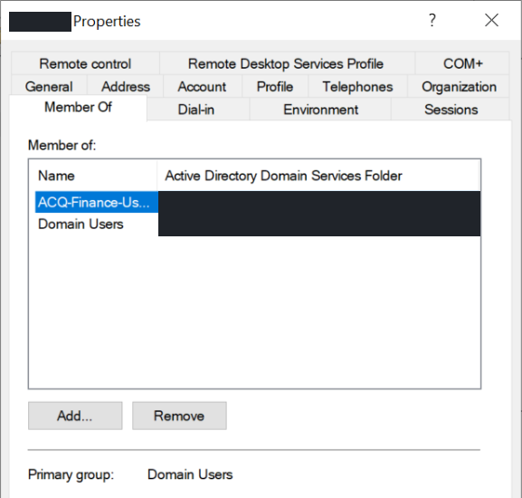
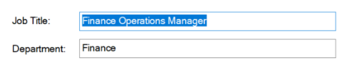
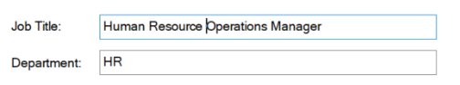
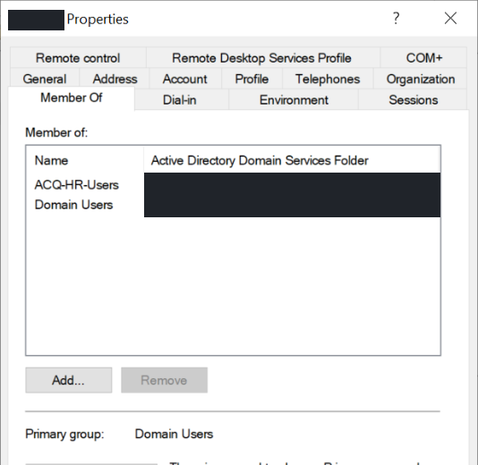
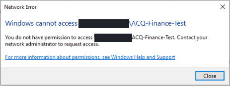
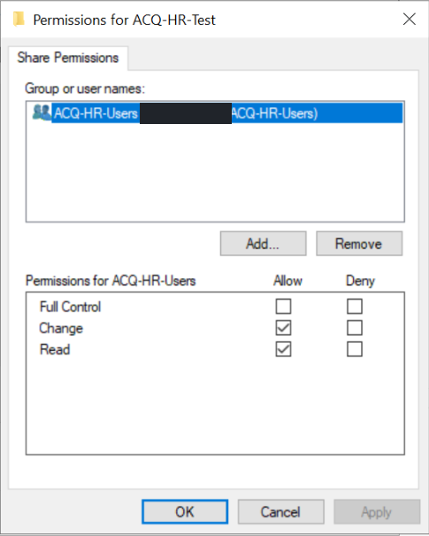
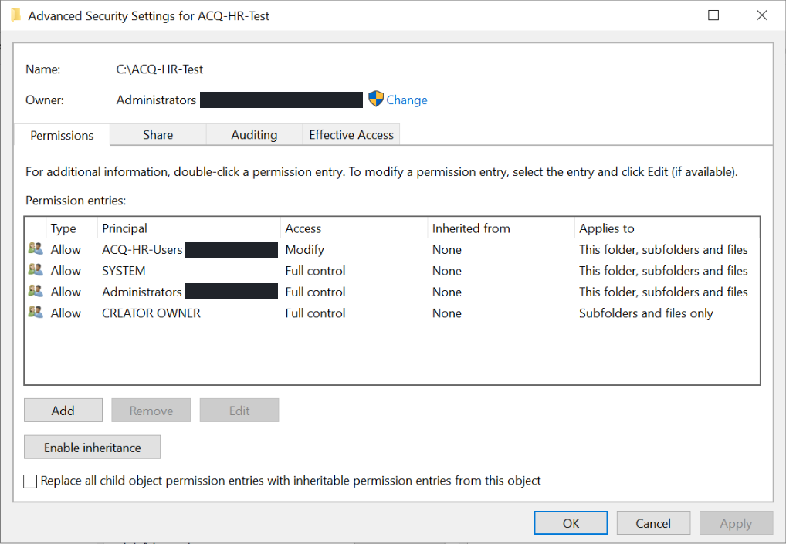
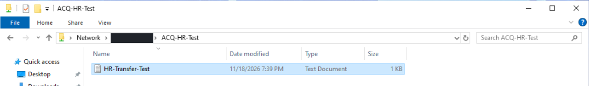
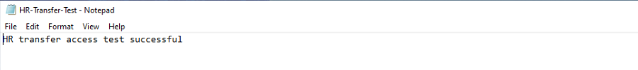

# AD Department Transfer and Access Validation

**Jade-Sec IAM home lab · Identity lifecycle management — Mover**

I simulated Cameron Carter’s transfer from Finance to HR using Active Directory on Windows Server 2022 and a domain-joined Windows client in VMware. I updated his role and security groups, verified that Finance access was denied, and tested HR access by saving, reopening, and deleting a file.

## Scenario and changes

The scenario represented an approved HR transfer. The request and approval workflow were simulated.

| Item | Before | After |
| --- | --- | --- |
| Department | Finance | HR |
| Job title | Finance Operations Manager | Human Resource Operations Manager |
| Department group | ACQ-Finance-Users | ACQ-HR-Users |
| Primary group | Domain Users | Domain Users |
| Finance share | Previously accessible | Access denied |
| HR share | Created during this exercise | Accessible |

## Implementation

1. **Review and update the account.** In Active Directory Users and Computers, I checked the Organization and Member Of tabs, then changed the department and title. Updating those attributes did not automatically change group membership in this lab.
2. **Update access assignments.** I added ACQ-HR-Users and removed ACQ-Finance-Users, retaining Domain Users. I signed Cameron out and back in on the client to test with updated group information.
3. **Test previous access.** Opening the Finance share returned a permissions denial.
4. **Prepare the new resource.** I created `C:\ACQ-HR-Test` on the server. At the SMB share level, I removed Everyone and granted ACQ-HR-Users Change and Read. At the NTFS level, I granted that group Modify.
5. **Resolve inherited permissions.** Windows blocked removal of two Users entries inherited from C:\. I disabled inheritance on the HR test folder, converted inherited entries into explicit permissions, then removed both Users entries. I retained SYSTEM, Administrators, and CREATOR OWNER.
6. **Test new access.** From Cameron’s client session, I opened the HR share. The New menu lacked a text-document option, so I used Notepad to save `HR-Transfer-Test.txt` directly through the network path.

## Validation

| Test | Result |
| --- | --- |
| Finance share after transfer | Permission denied |
| HR share after transfer | Opened successfully |
| Create and save the HR test file | Successful |
| Close and reopen the file | Saved text remained |
| Delete the HR test file | Successful |

The screenshots document account settings, group memberships, Finance denial, HR permissions, the test file, and its contents. The updated role screenshot shows values entered during the change. Saving those changes, the fresh sign-in, reopening with text intact, and deletion were confirmed during the guided manual lab. The file screenshots show the file before deletion.

## Evidence

Account settings and group memberships

**Before the transfer**

**Transfer changes**

Finance denial and HR permission configuration

HR file access

*Screenshots are cropped to the relevant evidence, with account identifiers, domain names, and hostnames concealed.*

## Lessons and interview explanation

Removing obsolete Finance membership applied least privilege and prevented privilege creep. Reviewing both share and NTFS permissions helped establish the intended HR access. Testing both denied and allowed outcomes verified the transfer.

> In my Active Directory home lab, I simulated a Finance-to-HR transfer. I updated the employee’s department and title, replaced the Finance group membership with HR membership, and tested from a fresh client sign-in. Finance access was denied, while HR access worked. I also resolved an inherited-permissions warning and verified that the user could save, reopen, and delete a file in the HR share.

This exercise covered one AD user and two SMB resources. Related work includes [bulk acquisition onboarding](../jade-sec-ad-bulk-onboarding/README.md) and [group-based access control](../ad-group-based-access-control-and-validation/README.md).
