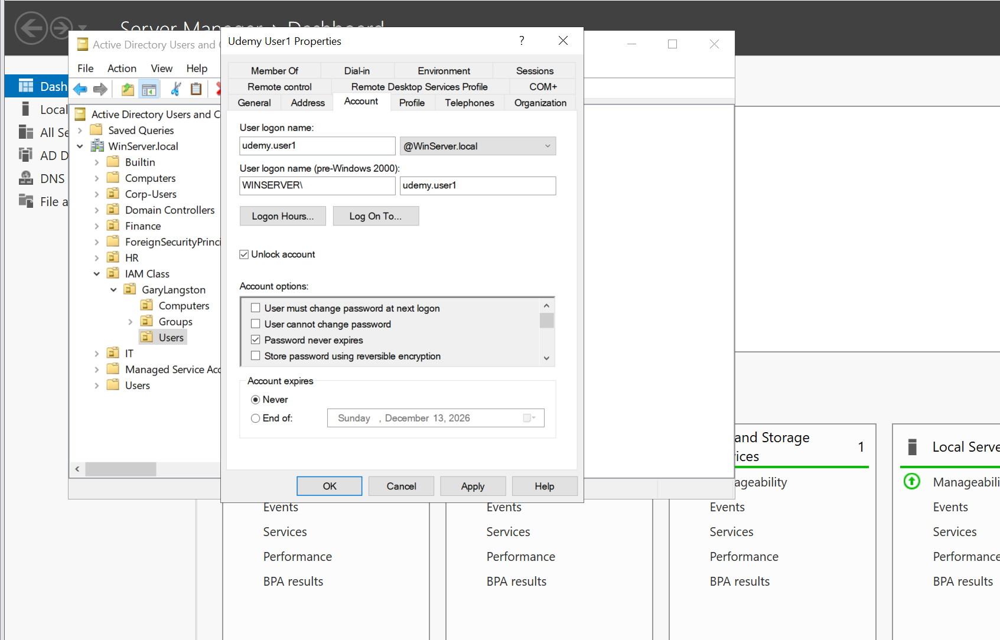

# Active Directory Password Policy and GPO Scope

**IAM home lab | Windows Server 2022 and Windows 10 | November 11, 2026**

I moved a domain-joined workstation into a lab organizational unit (OU), created a Group Policy Object (GPO), and configured the password settings specified in my Udemy IAM exercise. During testing, Windows rejected a password change. I used that result to examine the difference between a GPO link, the policy a computer receives, and the password policy that governs the account being tested.

## Objective

The exercise was to identify the client computer in Active Directory, move it into the course's **Computers** OU, and link a password-policy GPO to the parent lab OU. The course also called for refreshing policy with `gpupdate /force` and testing password changes as a standard user with candidates on either side of the configured length threshold.

| Component | Lab environment |
| --- | --- |
| Directory | Active Directory Domain Services, `WinServer.local` |
| Server | `WIN-SERVER`, Windows Server 2022 domain controller |
| Test workstation | `WIN-VICTIM`, domain-joined Windows 10 VM |
| Workstation location | `IAM Class → GaryLangston → Computers` |
| GPO | `Udemy Group Policy`, linked at the `GaryLangston` parent OU |
| Tools | Active Directory Users and Computers, Group Policy Management, Command Prompt |

## Implementation

1. **Identify the target workstation.** I ran `hostname` on the Windows client and confirmed `WIN-VICTIM`. In Active Directory Users and Computers, I searched `WinServer.local` for the corresponding computer object. [Hostname output](screenshots/01-workstation-hostname.png) · [AD search result](screenshots/02-computer-object-search.png)
2. **Move the computer object.** I selected the lab **Computers** OU and verified that `WIN-VICTIM` appeared there after the move. [Move dialog](screenshots/03-move-to-computers-ou.png)

   

3. **Create and link the GPO.** In Group Policy Management, I linked `Udemy Group Policy` to the parent lab OU. The linked GPO list shows **Link Enabled: Yes** and **Enforced: Yes**.

   

4. **Configure Password Policy.** I edited the settings under **Computer Configuration → Policies → Windows Settings → Security Settings → Account Policies → Password Policy**.

   | Setting | Configured value |
   | --- | --- |
   | Enforce password history | 0 passwords remembered |
   | Minimum password length | 6 characters |
   | Password must meet complexity requirements | Disabled |

   These values were prescribed for the lab exercise.

   

## Test result and troubleshooting

Windows rejected a password change and displayed a message about length, complexity, or history requirements. The screenshot captures the rejection without identifying the account context, the attempted password's characteristics, or the specific requirement that caused it.


| Check | Evidence |
| --- | --- |
| Target workstation and OU placement | Confirmed by the hostname and directory screenshots |
| GPO link and configured values | Confirmed in Group Policy Management |
| Computer received this GPO | Requires an applied policy report from `WIN-VICTIM` |
| Password behavior | One rejection captured. A successful change and the source of the effective rule remain to be verified. |

I initially questioned whether the **WIN-SERVER** name in the editor meant I was targeting the server. The computer object and GPO link determine the intended scope here. The lab workstation sits under the parent OU shown in the link view. Checking the GPO's **Scope → Links** in GPMC would confirm whether it has any additional links.

**Enforced** is a property of a GPO link. It affects precedence and inheritance within the link's scope. For these password settings, a GPO linked below the domain root can govern local accounts on member computers in scope. An AD domain user's password is governed by the effective domain password policy or a fine-grained password policy that applies to that user. The rejection is consistent with an effective password rule, but it does not identify that rule or attribute it to this GPO.

## Follow-up verification

1. On **WIN-VICTIM**, use an elevated Command Prompt to refresh computer policy and check the applied computer GPOs.

   ```cmd
   gpupdate /force /target:computer
   gpresult /r /scope computer
   ```

2. In the actual test user's session, run `whoami` to establish whether the account belongs to `WIN-VICTIM` or the AD domain. For the workstation's local account policy, review `net accounts` on the workstation. For a domain user, compare the default domain policy with any resultant fine-grained policy using the AD PowerShell module.

   ```powershell
   Get-ADDefaultDomainPasswordPolicy
   Get-ADUserResultantPasswordPolicy -Identity '<test-user-sAMAccountName>'
   ```

3. With a disposable local standard account and a confirmed effective six-character minimum, test a five-character candidate and a fresh candidate of at least six characters. Keep the other conditions consistent and account for any additional effective rules. Record the expected and actual results without saving the passwords. If the exercise is meant to test a separate policy for a specific domain user, use a fine-grained password policy in a separate follow-up.

## Follow-up lab: password requirements and account lockout

### Password requirements

On November 13, I revisited **Udemy Group Policy** and entered the next exercise values in **Account Policies → Password Policy**.

| Setting | Initial value | Follow-up value | Evidence |
| --- | --- | --- | --- |
| Password history | 0 passwords | 5 passwords | [History setting](screenshots/08-password-history-five.png) |
| Minimum password length | 6 characters | 8 characters | [Length setting](screenshots/09-minimum-length-eight.png) |
| Complexity | Disabled | Enabled selected | [Complexity dialog](screenshots/10-complexity-enabled-selection.png) |

The [refresh output](screenshots/11-server-policy-refresh.png) shows `gpupdate /force` completed on Windows Server 2022. The complexity screenshot shows the selection before confirming the change. The saved settings, applied policy on `WIN-VICTIM`, and password-change outcomes remain to be verified.

### Lockout configuration and domain account recovery

I opened [Account Lockout Policy](screenshots/12-lockout-policy-location.png) in the same GPO. Setting the duration prompted Windows to [suggest a five-attempt threshold](screenshots/14-suggested-lockout-values.png). I entered three attempts to match the exercise.

| Setting | Value entered | Evidence |
| --- | --- | --- |
| Account lockout threshold | 3 failed sign-ins | [Threshold](screenshots/15-lockout-threshold-three.png) |
| Account lockout duration | 30 minutes | [Duration](screenshots/13-lockout-duration-30.png) |
| Reset account lockout counter after | 30 minutes | [Counter reset](screenshots/16-lockout-counter-reset-30.png) |

The duration starts when the account locks. The counter reset interval controls when the failed sign-in count clears before reaching the threshold.

In Active Directory Users and Computers, I selected **Unlock account** for the domain user `WINSERVER\udemy.user1`. The screenshot shows the unlock selection. A check of the saved account state and a successful sign-in would verify recovery.



### Verification plan

- On `WIN-VICTIM`, check the applied GPO with `gpresult /r /scope computer` from an elevated Command Prompt and confirm the effective local lockout settings with `net accounts`. Use a disposable local standard account to test the workstation policy.
- On `WIN-SERVER`, check the effective AD password and lockout settings for the domain user. The workstation OU policy can govern local accounts in scope. The domain account follows the domain default or an applicable fine-grained policy. Compare the values before attributing the lockout to any policy.

  ```powershell
  $policy = Get-ADUserResultantPasswordPolicy -Identity 'udemy.user1'
  if (-not $policy) { $policy = Get-ADDefaultDomainPasswordPolicy }
  $policy | Select-Object LockoutThreshold, LockoutDuration, LockoutObservationWindow
  Get-ADUser -Identity 'udemy.user1' -Properties LockedOut |
      Select-Object SamAccountName, LockedOut
  ```

## Interview explanation

> In my Active Directory lab, I confirmed the workstation name, moved its computer object into the lab OU, and configured a password-policy GPO at the parent OU. Windows rejected one password change during testing. The GPO editor showed what I configured, so my next step was to check the workstation's applied policies and identify the account I tested. That distinction matters because a workstation OU policy and a domain user's password policy have different scopes.

## References

- Udemy IAM course lab objectives, slides 34–38.
- [Microsoft Learn — Account Lockout Policy](https://learn.microsoft.com/en-us/previous-versions/windows/it-pro/windows-10/security/threat-protection/security-policy-settings/account-lockout-policy)
- [Microsoft Learn — Account policies](https://learn.microsoft.com/en-us/previous-versions/windows/it-pro/windows-10/security/threat-protection/security-policy-settings/account-policies)
- [Microsoft Learn — Group Policy processing](https://learn.microsoft.com/en-us/windows-server/identity/ad-ds/manage/group-policy/group-policy-processing)
- [Microsoft Learn — Fine-grained password policies for AD DS](https://learn.microsoft.com/en-us/windows-server/identity/ad-ds/get-started/adac/fine-grained-password-policies)
