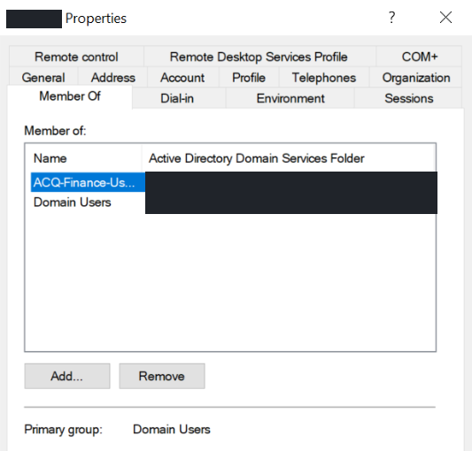
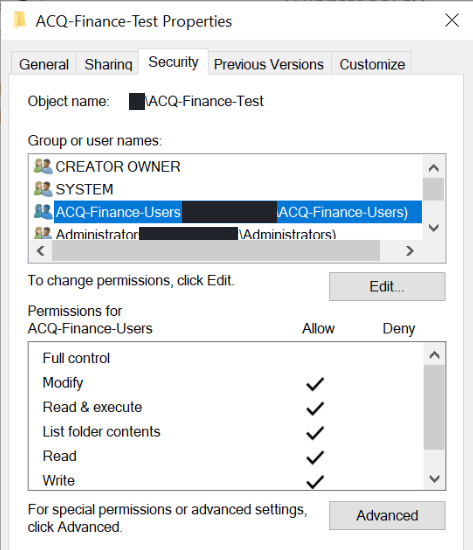
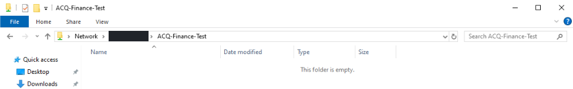
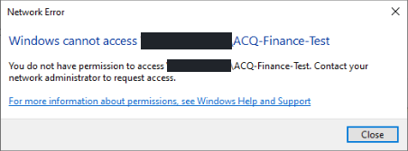
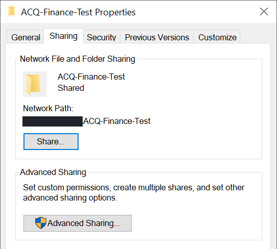
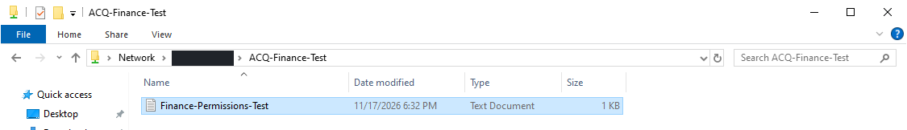
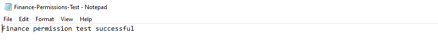

# AD Group Based Access Control and Validation

In my VMware home lab, I followed up on the [Jade-Sec bulk onboarding project](../jade-sec-ad-bulk-onboarding/README.md). After verifying all 200 accounts in their staged, disabled state, I enabled two Wave 1 test accounts for a Day 1 access pilot. I set a temporary password for each account and confirmed that Windows prompted both users to change it at first sign-in.

On Windows Server 2022, I created the `ACQ-Finance-Test` SMB share, removed `Everyone` from its share permissions, and granted the `ACQ-Finance-Users` Active Directory security group **Change** and **Read** at the share level and **Modify** at the NTFS level. I checked the Finance test account’s group membership in Active Directory Users and Computers.

I tested the same share from a domain-joined Windows 10 client in separate Finance and HR user sessions. The initial attempt used an incorrect server name. I copied the exact UNC path from the folder’s **Sharing** tab and used that path for both tests.

| Test account | Expected result | Observed result |
| --- | --- | --- |
| Finance | Open the Finance share | File Explorer opened the share and displayed its empty contents. |
| HR | Sign in to Windows and be denied access to the Finance share | Windows sign-in succeeded. File Explorer reported insufficient permission to open the share. |

The pilot verified folder access for the Finance account and access denial for the HR account. The NTFS screenshot shows **Modify** was configured. The activation pilot covered two test accounts.

## Follow-up file permission testing

I continued the Finance permissions test from the Windows client. When the share initially returned **0x80070043 — The network name cannot be found**, I checked the server folder’s **Sharing** tab and copied its exact network path into the client’s File Explorer. The folder then opened without an error.

| Action | Expected result | Manual test result |
| --- | --- | --- |
| Create `Finance-Permissions-Test.txt` in the share | File is created | Passed |
| Open the file, enter test text, and save | Changes save successfully | Passed |
| Close and reopen the file | Saved text is still present | Passed |
| Close the file and delete it from the share | File is removed | Passed |

The manual results were confirmed during the guided test. Follow-up screenshots show the server folder’s shared status and network path, the test file listed in the share, and its text displayed in Notepad. Reopening with the saved text present and successful deletion were confirmed by the operator. The submitted screenshots show the file before deletion.

The follow-up completed the planned create, save, reopen, and delete checks for the Finance permissions test.

Screenshot evidence

**Finance group membership**

**Finance NTFS permissions**

**Finance share opened**

**HR share access denied**

**Share status and network path**

**Test file in the share**

**Test file content**

*Screenshots are cropped to the relevant windows, with lab hostnames concealed.*

The [Okta and ServiceNow SAML pilot](../okta-servicenow-sso/README.md) documents the related application-access work.
