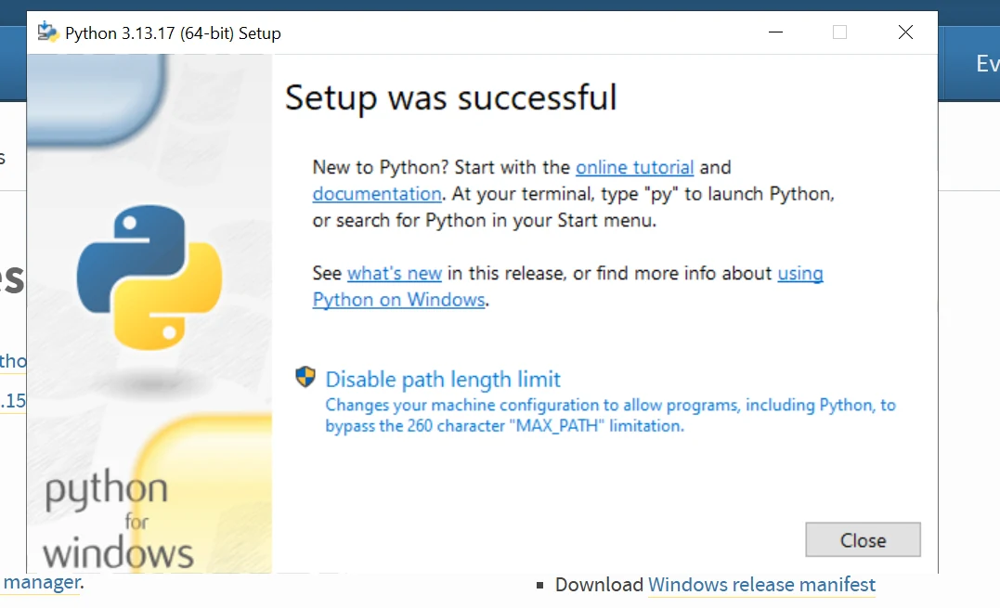
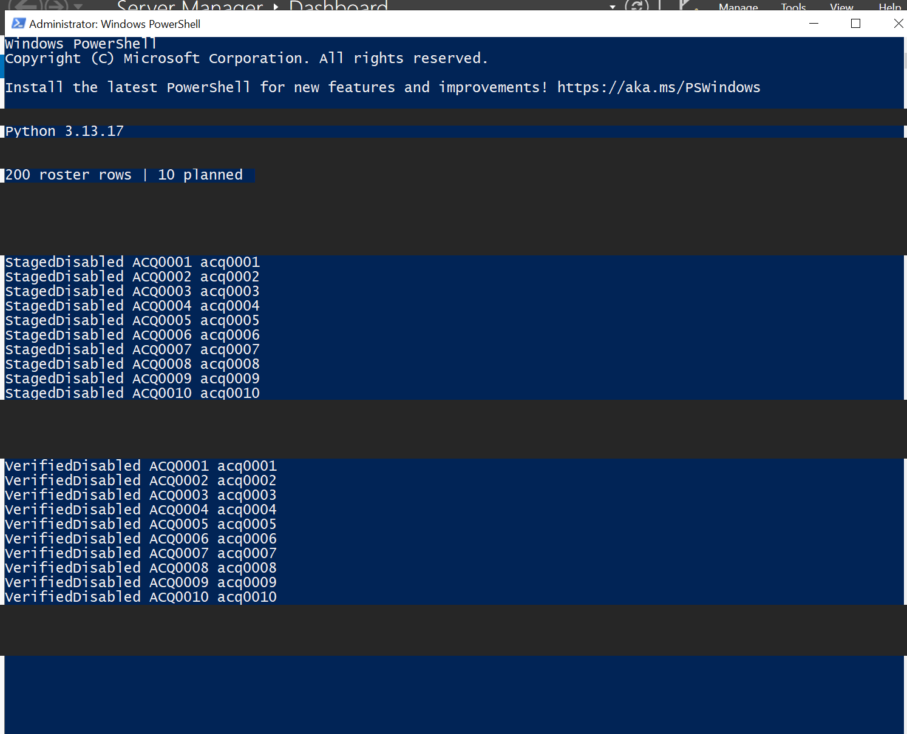
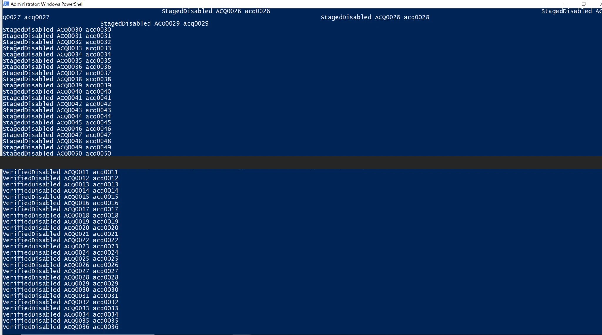
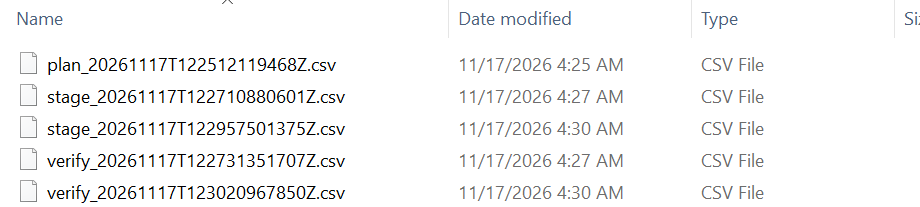
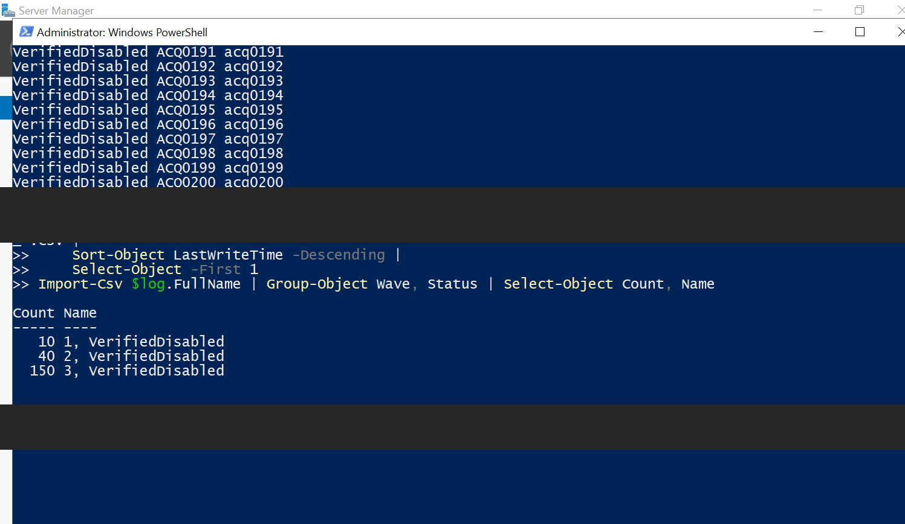
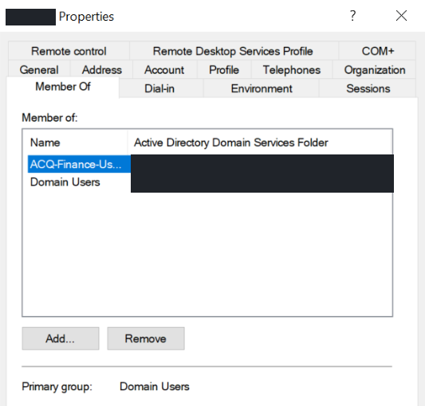
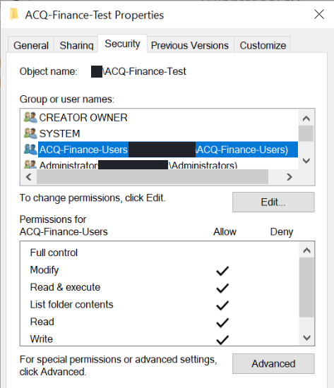
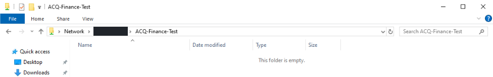
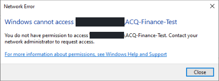

# Jade-Sec IAM Lab | Bulk Active Directory Onboarding for 200 Users

I simulated onboarding 200 employees after an acquisition. Using a synthetic HR roster in my Windows Server 2022 home lab, I provisioned and verified all 200 accounts in my lab domain across three waves. I kept the accounts disabled so I could check their access assignments before Day 1 activation.

## HR handoff and provisioning controls

The HR workbook supplied a CSV with employee IDs, names, departments, managers, start dates, approval status, and ticket IDs. The Python script used the signed-in operator's permissions to call the Windows PowerShell ActiveDirectory module.

- **Identity matching.** The lowercased employee ID became the account name. The script checked employee ID, account name, and UPN against AD to flag collisions before staging.
- **Scope and access.** Each wave had its own organizational unit under `Acquisition-Lab`. Department determined the baseline security group, and manager relationships came from employee IDs in the roster.
- **Approval and verification.** The script processed approved records, staged accounts disabled, and then read the accounts back from AD to check their attributes, OU placement, manager assignments, and direct group memberships.

## Environment setup and troubleshooting

The first attempt stopped before reaching AD because Windows PowerShell couldn't find either `python` or `py`. The ActiveDirectory module was already present. I installed Python 3.13.17 on the Server VM, moved the extracted lab folder into the VM, and confirmed `python --version` in a fresh PowerShell session.

<details>
<summary>Python installation evidence</summary>



</details>

## Pilot and staged rollout

I started with a dry run and confirmed the script read 200 roster rows and selected 10 for Wave 1. I created the lab OUs and security groups, staged the pilot, and checked its results before moving on to Waves 2 and 3.

```powershell
python .\onboard_ad.py plan .\acquisition_roster_200.csv --wave 1
python .\onboard_ad.py setup
python .\onboard_ad.py stage .\acquisition_roster_200.csv --wave 1
python .\onboard_ad.py verify .\acquisition_roster_200.csv --wave 1
```

The script wrote timestamped CSVs for planning, staging, and verification. I used the logs to reconcile the rollout by wave.

<details>
<summary>Provisioning and CSV log evidence</summary>

**Wave 1 pilot**

The screenshot shows the 200-row dry run selecting 10 accounts, followed by staging and verification of the pilot.



**Wave 2 expansion**

The screenshot shows part of the staging and verification output for the next 40 accounts. The complete wave counts appear in the final reconciliation.



**Timestamped CSV logs**



</details>

## Final verification

After staging Wave 3, I ran `verify --wave all`. I grouped the resulting CSV by wave and status and checked the totals against the HR roster.

| Wave | Planned | Verified disabled | Cumulative verified |
| --- | ---: | ---: | ---: |
| 1 · Pilot | 10 | 10 | 10 |
| 2 · Expansion | 40 | 40 | 50 |
| 3 · Final rollout | 150 | 150 | 200 |
| **Total** | **200** | **200** | **200** |



*Screenshots have been cropped or redacted to conceal local paths and lab hostnames.*

## AD Group Based Access Control and Validation

After verifying all 200 accounts in their staged, disabled state, I enabled two Wave 1 test accounts for a Day 1 access pilot. I set a temporary password for each account and confirmed that Windows prompted both users to change it at first sign-in.

On Windows Server 2022, I created the `ACQ-Finance-Test` SMB share, removed `Everyone` from its share permissions, and granted the `ACQ-Finance-Users` Active Directory security group **Change** and **Read** at the share level and **Modify** at the NTFS level. I checked the Finance test account’s group membership in Active Directory Users and Computers.

I tested the same share from a domain-joined Windows 10 client in separate Finance and HR user sessions. The initial attempt used an incorrect server name. I copied the exact UNC path from the folder’s **Sharing** tab and used that path for both tests.

| Test account | Expected result | Observed result |
| --- | --- | --- |
| Finance | Open the Finance share | File Explorer opened the share and displayed its empty contents. |
| HR | Sign in to Windows and be denied access to the Finance share | Windows sign-in succeeded. File Explorer reported insufficient permission to open the share. |

The pilot verified folder access for the Finance account and access denial for the HR account. The NTFS screenshot shows **Modify** was configured. File creation, editing, and deletion remain untested. The activation pilot covered two test accounts.

<details>
<summary>Phase 2 screenshot evidence</summary>

**Finance group membership**



**Finance NTFS permissions**



**Finance share opened**



**HR share access denied**



</details>

The [Okta and ServiceNow SAML pilot](../okta-servicenow-sso/README.md) documents the related application-access work.
