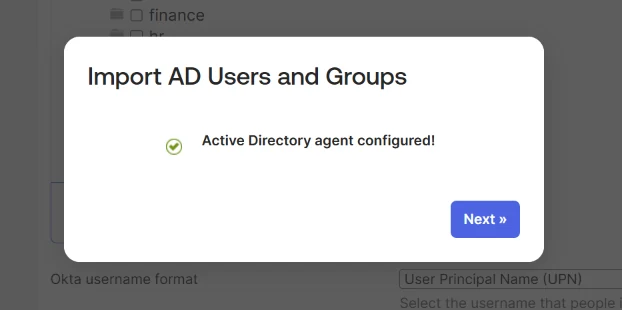
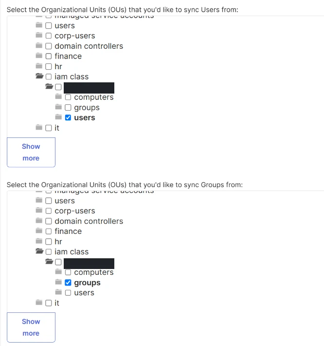
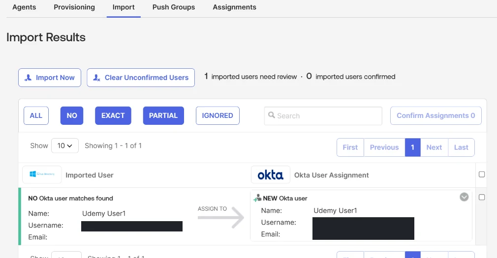
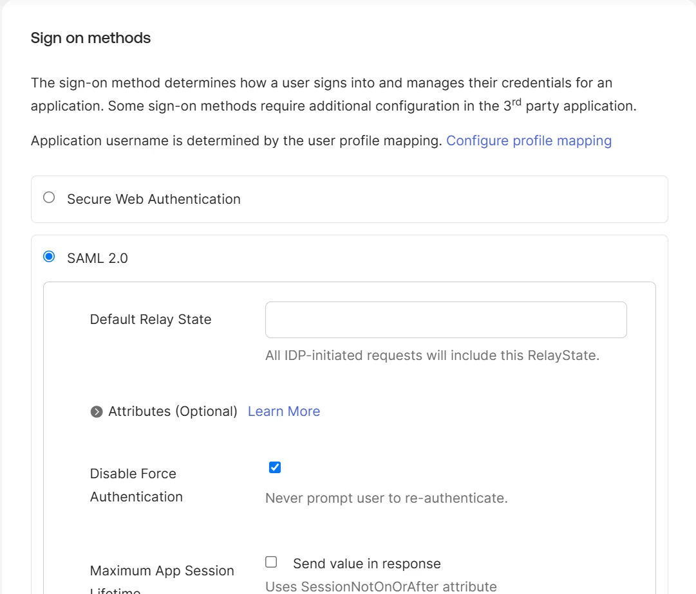
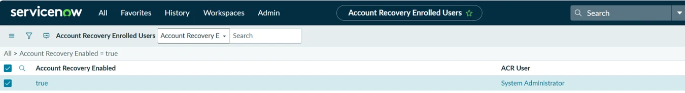
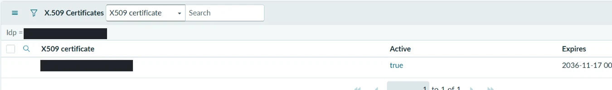
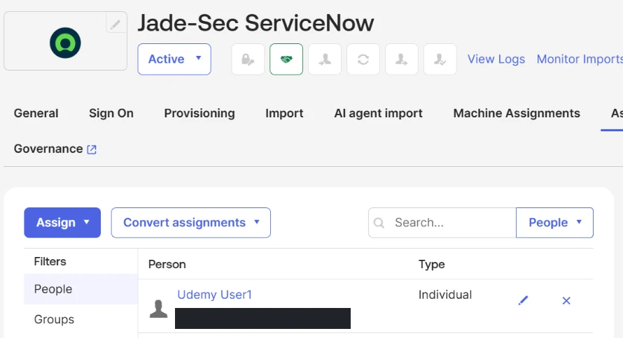
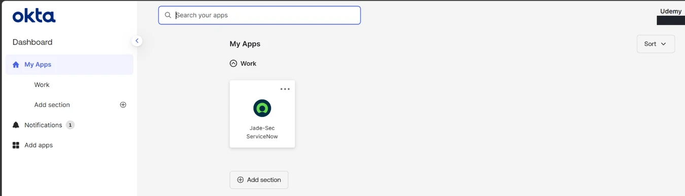
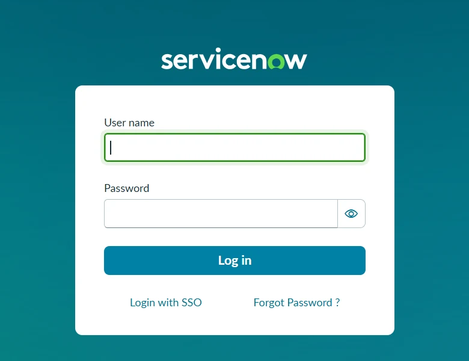

# Okta and ServiceNow SAML SSO Pilot

I used my Windows Server 2022 home lab to bring an Active Directory test user into Okta and pilot SAML 2.0 single sign-on to a ServiceNow Personal Developer Instance. I assigned the app to one test user and enrolled the ServiceNow administrator in Account Recovery so I had a way back into the SSO configuration if needed.

**Pilot status:** I verified that the test user could sign in to Okta and see the assigned ServiceNow app. Launching the tile landed on the ServiceNow sign-in form. An authenticated ServiceNow session through Okta is still pending.

## Lab environment

| Component | Role |
| --- | --- |
| Windows Server 2022 and Active Directory | Source directory for the lab test user |
| Okta AD Agent and Okta Integrator Free | Directory integration and identity provider |
| ServiceNow Personal Developer Instance | SAML service provider |
| Udemy User1 | Test identity individually assigned to Jade-Sec ServiceNow |

## 1. Scope the Active Directory import

I configured the Okta AD Agent and selected the lab's Users and Groups organizational units separately for import. I used the AD User Principal Name (UPN) as the Okta username format. Okta found one test user and showed that there was no existing Okta match. I reviewed and confirmed the import as a new Okta user.

Active Directory integration evidence

**Agent configuration confirmation**

**Scoped import settings**

**Import review before confirmation**

## 2. Set up SAML and administrator recovery

I added the **ServiceNow UD** integration in Okta as **Jade-Sec ServiceNow** and selected **SAML 2.0**. In ServiceNow, I installed the Multi-Provider SSO plugin, enabled Account Recovery, and enrolled the System Administrator. I imported the Okta identity provider metadata into ServiceNow and checked that the resulting X.509 certificate record was marked active.

SAML configuration and recovery evidence

**Okta sign-on method**

**Administrator recovery enrollment**

**Imported certificate**

## 3. Assign the app and test from Okta

I assigned Jade-Sec ServiceNow to **Udemy User1** as an individual assignment. I signed in to the Okta end-user dashboard as that account, saw the ServiceNow tile in **My Apps**, and launched it from there.

End-user dashboard

## Troubleshooting

The browser reached the ServiceNow username and password form after I launched the app from Okta. The app assignment and tile were confirmed. I still need to identify why the launch ended at the form and verify that ServiceNow opens a session for the test user.

My next checks are to review the ServiceNow identity provider's activation state and **Test Connection** result, then compare the SAML NameID sent by Okta with the field and value ServiceNow uses to match the test user. I will repeat the tile launch in a fresh private window and verify the identity in the ServiceNow user menu. [Okta's ServiceNow SAML setup guide](https://saml-doc.okta.com/SAML_Docs/How-to-Configure-SAML-2.0-for-ServiceNow.html)

## What I learned

This lab gave me three separate checkpoints to verify. The directory import brought the test identity into Okta. The individual assignment gave that identity the ServiceNow tile. The final checkpoint is a ServiceNow session under the same test identity.
